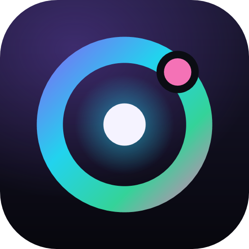

<p align="center"></p>

# Éteris

Navegador web privado para Windows, com bloqueio de rastreadores e anúncios ativo por defeito, páginas internas cuidadas e uma interface que se adapta a cada site. Tudo fica no computador: sem contas, sem telemetria.

## Instalar

Descarrega `EterisBrowser-win-Setup.exe` do [último release](https://github.com/mrtjr/eteris/releases/latest) e executa-o. Instala por utilizador, sem permissões de administrador, e atualiza-se sozinho.

## O que o Éteris faz

**Privacidade**
- Escudo com as listas do uBlock Origin (motor adblock-rust, ~200 mil regras), scriptlets e regras cosméticas; avisos de cookies removidos.
- HTTPS primeiro, cookies de terceiros bloqueados, WebRTC sem fuga de IP, «Não rastrear» e GPC.
- Vídeos com som automático bloqueados até um clique.
- «Esconder elemento»: clique num anúncio ou caixa e desaparece nesse site para sempre.
- Janelas privadas com perfil em memória; «Esquecer os últimos 15 min / 1 hora»; apagar histórico, cookies e cache.
- Painel semanal na nova aba: rastreadores bloqueados por dia e estimativa do que foi poupado.
- DNS cifrado, links sem rastreio, modo rigoroso por site, notificações recusadas sem perguntar, apagar dados ao fechar.

**Barra de endereço**
- Contas e conversões instantâneas (`(12+8)*1,5`, `10 km em milhas`, `30 °C em F`).
- Bangs: `!w`, `!yt`, `!gh`, `!map`, `!r`, `!so`… (escreva `!` para ver a lista).
- Sugestões de histórico, favoritos e abas abertas («Mudar para este separador»); sugestões do motor opcionais.
- Painel do site (cadeado): ligação, permissões revogáveis, apagar cookies e dados do site.

**Abas e janelas**
- Abas verticais (encolhíveis) ou no topo; ecrã dividido lado a lado ou empilhado (abrir um link ao lado, arrastar uma aba até à margem, trocar lados), lembrado na sessão.
- Abas fixadas, a dormir (libertam memória), silenciar, arrastar, cartão ao passar o rato; nome próprio, emoji, cor e nota «porque abri isto?» por aba (ficam na sessão e nas sessões guardadas); «Trancar» (não fecha por engano nem adormece), «Feito» (sai da faixa para «Feitas hoje» no Radar) e «Adiar até…» (volta à hora escolhida, com aviso; «Adiadas» no Radar); Arquivo automático das abas sem visita há N dias (desvanecem e, depois de escolher o prazo em Definições › Abas, vão para «Arquivo» no Radar, de onde se repõem).
- Multi-seleção de abas (Ctrl/Shift+clique) com ações em bloco: copiar links (texto e HTML), agrupar, mover para uma janela, adormecer, trancar, fechar.
- Espaços: ambientes de abas na mesma janela, cada um com nome, cor e emoji, a sua faixa de abas, aba ativa e ecrã dividido (chips na barra de título, Ctrl+Alt+1…9, «Mover para o Espaço…» no menu da aba ou arrastar até ao chip); as abas dos outros Espaços dormem (menos as trancadas e as que tocam som), a cor do Espaço tinge a barra e tudo fica na sessão; «Noutros Espaços» no Radar.
- Paleta de comandos (Ctrl+K), folha de atalhos (F1), abas fechadas recentemente.
- A janela lembra-se do tamanho e posição; links de outras apps abrem na janela aberta; lista de atalhos na barra de tarefas.
- Grupos de abas com nome e cor (pré-visualização ao pairar na etiqueta); sessões guardadas; fechar duplicadas e ordenar por site; reabrir janela fechada.
- Centro de multimédia (♫) com tudo o que toca; janela flutuante sempre por cima (Ctrl+Shift+M).

**Ler e ver**
- Espreitar um link (Alt+clique): título, imagem, tempo de leitura e primeiros parágrafos num cartão, sem abrir aba nem deixar rasto.
- Modo de leitura (F9) com temas escuro, sépia e claro, «Ouvir» em voz alta (vozes locais) e lista «Ler mais tarde».
- Barra lateral (Ctrl+Shift+B) com Notas, Para ler, Favoritos, Histórico e sites fixados que abrem dentro da barra.
- Notas ao lado da página (Ctrl+Shift+E), código QR da página, escurecer sites, links para um destaque.
- Zoom memorizado por site, ecrã inteiro para vídeos, captura da página inteira (Ctrl+Shift+S).
- Tema escuro, claro ou do Windows; material Mica do Windows 11, cor da interface adaptada ao site.
- Nova aba personalizável (5 temas de fundo), páginas `eteris://history`, `eteris://bookmarks`, `eteris://settings`.

## Desenvolvimento

```
dotnet build
dotnet test
```

## Licença

O Éteris é software livre: pode usá-lo, estudá-lo, alterá-lo e redistribuí-lo nos termos da
[GNU GPL versão 3 ou posterior](LICENSE). Os componentes de terceiros e as respetivas licenças estão em
[THIRD-PARTY-NOTICES.md](THIRD-PARTY-NOTICES.md) e na pasta [licenses/](licenses/INDEX.md).

Design e decisões: [docs/superpowers/specs/2026-11-05-eteris-browser-design.md](docs/superpowers/specs/2026-11-05-eteris-browser-design.md).
Alterações: [CHANGELOG.md](CHANGELOG.md).
